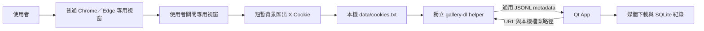

# 程式結構與信任邊界

桌面 App 與 Chrome 擴充功能是兩個可獨立使用的版本，不需要彼此安裝。

## 桌面 App

| 檔案 | 責任 |
| --- | --- |
| `desktop/main.py` | Qt 視窗控制、背景執行緒與停止／關閉協調 |
| `desktop/ui_design.py`、`desktop/ui_theme.py`、`desktop/gallery_widgets.py` | 既有畫廊介面、明暗主題與原生日曆／提醒 |
| `desktop/login_browser.py` | 普通瀏覽器登入、專用設定檔占用與程序擁有權驗證、X Cookie 安全儲存 |
| `tools/save_cookies.py` | 相同登入流程的選用命令列入口 |
| `desktop/gallery_client.py` | 啟動獨立下載解析器，讀取通用 JSONL 資料，管理取消／錯誤／子程序生命週期 |
| `extractor/gallery_bridge.py` | 獨立 GPL-2.0-only 命令列程式，以 gallery-dl 解析 X 來源；不匯入 Qt 或 App |
| `desktop/downloader.py` | 全來源完整標籤條件、日期／數量限制、媒體傳輸及內容驗證 |
| `desktop/thread_collection.py` | 驗證同作者、討論串與祖先鏈；僅從符合標籤的原貼文延伸留言資格 |
| `desktop/storage.py` | SQLite 歷史、重試與去重 |
| `desktop/i18n.py`、`desktop/locales/` | 語言偵測、集中翻譯、Qt 標準控制項及同視窗重翻譯；不改使用者輸入 |
| `desktop/network.py` | 單次工作可選的本機 WARP SOCKS5 路徑、連接埠驗證與不含帳密的可用性檢查 |
| `desktop/resources_rc.py` | 從 `assets/` 或 PyInstaller 目錄取得圖片，無內嵌 Base64 或共用暫存圖片 |
| `desktop/author_dialog.py` | 使用者主動開啟的作者資訊；關閉 App 不會強制顯示 |
| `desktop/help_dialog.py` | 可重開的使用說明與首次引導，沿用主視窗主題 |
| `desktop/driver_manager.py` | 舊版 ChromeDriver 的相容更新工具；新版下載與登入不依賴它 |
| `packaging/` | 兩個獨立程序的 PyInstaller specs、版本資訊與資源清單 |

GUI 不匯入 `gallery_dl`，解析器不匯入 PyQt6。兩者以獨立程序運作，以標準輸入參數與 JSONL 交換公開貼文／媒體資料。完整 Cookie 值不出現在命令列、JSONL、紀錄或錯誤訊息。Qt 視窗不從背景執行緒直接更新；登入進度經 signal 傳回。

原始碼入口為 `desktop/main.py`；控制端以獨立 Python 程序啟動 `extractor/gallery_bridge.py`。兩者仍以專案根目錄為本機 `data` 的位置。`tools/` 保留可選用的命令列入口，`tests/` 放離線測試，`assets/` 放普通圖片檔；各目錄不保存真人登入資料。

## 維護與擴充方式

分類依功能責任與變更原因安排。`main.py` 負責組合元件與協調視窗生命週期；下載條件、檔案驗證、登入程序及 SQL 分別由自己的模組處理。介面在啟動工作前一次讀取設定，建立 `DownloadOptions` 交給 `DownloadEngine`，以 `RunResult` 回報結果；背景進度透過 Qt signal 更新介面。

| 要修改的功能 | 主要修改位置 | 應核對的行為與測試 |
| --- | --- | --- |
| 畫面、主題或使用說明 | `desktop/ui_design.py`、`ui_theme.py`、`gallery_widgets.py`、`help_dialog.py` | `test_ui.py`、`test_gallery_widgets.py`、`test_help_dialog.py`；明暗主題與最小視窗 |
| 文案或支援語言 | `desktop/i18n.py`、`desktop/locales/*.json` | `test_i18n.py`、`test_main_i18n.py`；保留格式參數、連結、使用者欄位及首次引導語言 |
| WARP 或工作網路設定 | `desktop/network.py`；解析器自行驗證 CLI 輸入 | `test_network.py`、`test_gallery_client.py`、`test_gallery_bridge.py`；僅本機代理、代理 DNS、失敗不直連、不改全域設定 |
| 登入或 Cookie 儲存 | `desktop/login_browser.py`；`main.py` 僅處理操作及進度 | `test_login_browser.py`、`test_login_gui.py`；另以全新測試設定檔跑 `tools/login_browser_smoke.py` |
| 收集條件、日期、限額或補抓 | `desktop/downloader.py` 的 `DownloadOptions` 與 `DownloadEngine` | `test_downloader.py`；搜尋、作者、網址、重試都須通過相同完整標籤條件 |
| 同作者留言與繼承資格 | `desktop/thread_collection.py`、`downloader.py`、`storage.py` | 留言須有真實原貼文及回覆關聯證據；重試查 SQLite 關聯，不信任任意 metadata 聲稱的來源 |
| X 擷取方式或 gallery-dl 更新 | `extractor/gallery_bridge.py`；協定變更時同步 `desktop/gallery_client.py` | `test_gallery_bridge.py`、`test_gallery_client.py`；檢查 JSONL 完整結束、錯誤及取消 |
| 下載紀錄或資料庫欄位 | `desktop/storage.py` 的 `Store` | `test_storage.py`；以舊版合成資料庫驗證升級，不用真人歷史作 fixture |
| 套件、資源或 EXE 封裝 | `requirements*.txt`、`assets/`、`packaging/` | 重新建置 helper 與 GUI，再以只放主 EXE 的新目錄執行 smoke |

下載引擎可注入 `source` 與 HTTP `session`，讓來源與網路行為能以合成資料測試；來源透過 `iter_media(url)` 提供 `(media_url, metadata)`。未來新增來源時，先定義網址驗證、metadata 對應、登入與權限範圍，再新增來源實作；目前仍只接受 X，不會因替換擷取器就自動支援其他網站。來源不應存取 Qt 控制項或直接寫 SQLite，保持驗證與完成狀態由引擎統一管理。

新增功能先維持既有呼叫邊界；當同一模組出現不同責任或需獨立測試時再拆檔。擴充 SQLite schema 時以現有 `user_version` 建立逐版、可重複檢查的 migration，保留既有紀錄，並加入升級測試。程序協定、依賴版本與 schema 的變更需同步文件與測試，避免只更新介面。

語系設定儲存為 `system`、`zh_TW`、`zh_CN`、`en`、`ja` 或 `ko`。先讀語系才建立畫面與首次引導，切換時保留既有視窗、工作執行緒與欄位資料；Qt 自有按鈕／非原生選檔視窗另載入 `qtbase` 翻譯。新增文案用 `tr()` 與具名參數，四份 JSON 同步補齊；不要翻譯網址、標籤、作者帳號或下載內容。

WARP 是使用者另行管理的可選外部服務。App 對每次工作的媒體 Session 與獨立解析器設定固定 `socks5h://127.0.0.1:連接埠`，解析器另行驗證同一輸入，不匯入 GUI 網路模組。明確啟用時停用環境代理覆寫，且不切回直連；未啟用則保留電腦既有代理／CA 支援。人工登入及本機 CDP 都不使用此下載代理設定。媒體下載也不讀取個人的 `.netrc` 帳密。

## 登入的兩個階段

人工輸入帳密時，只開啟普通 Chrome／Edge 的 App 專用設定檔，沒有 CDP、Headless、Selenium 或 ChromeDriver。帳密只在網站輸入。

使用者關閉該專用視窗後，App 檢查設定檔占用，才短暫以同一瀏覽器、同一設定檔啟動背景匯出。只接受本次自有程序的本機端點，以 page target 的 `Network.getCookies` 指定 X／Twitter 網址；不先取得所有網站的 Cookie 再篩選。

Cookie 寫入前驗證必要組合，使用受限權限的暫存檔，再原子替換目的檔。失敗保留原檔；擷取完成或失敗都會清理本次背景程序。App 不終止人工登入視窗，也不讀取日常瀏覽器設定檔。

專用瀏覽器設定檔仍可能保存 Google 登入資料，因為登入本身在該瀏覽器進行。**X Cookie 匯出不包含 Google Cookie，不代表整個專用設定檔不含 Google 資料。** 詳見 [安全說明](../SECURITY.md)。

## 下載與完整性

Hashtag 搜尋、作者媒體頁與貼文網址先核對原貼文是否含任一指定完整標籤。明確啟用同作者留言補抓時，僅由已匹配原貼文授權該串的同作者留言，不要求留言重複帶標籤；不修改留言的真實 hashtags。優先核對作者數字 ID，再驗證 conversation／reply 關聯；起點是另一則留言時，還須確認候選是該起點的後代。缺少證據、旁支、祖先、他人及引用不能繼承資格。

`iter_media()` 維持普通來源資料介面，`iter_thread()` 與解析器 `--conversation` 只處理貼文網址，可回傳無媒體的原貼文 context。串流處理保留有上限的待驗證資料，不緩衝整個討論串。SQLite schema v2 增加原貼文 context、討論串證據及已驗證 membership；舊版合成資料庫需升級測試，遇到未知較新版 schema 不可降版。失敗重試會重新查原貼文資格與 membership，不能憑媒體 metadata 自行宣稱 thread root。

游標與資料分頁取代畫面滾動；X 未提供的內容仍可能遺漏。媒體成功傳輸並通過內容驗證後才寫為完成，重遇已有紀錄時核對檔案，遺失或不完整者可補抓。日期與貼文數以符合標籤的起點計算，符合資格的留言媒體不另消耗貼文名額。

Chrome 擴充版改用 Chrome downloads 與 IndexedDB；它的驗證能力和桌面版不同，不能把 Chrome 回報完成當成逐張解碼與 SHA256 驗證。

## 授權範圍

桌面 GUI／控制端 GPL-3.0-only；獨立 gallery bridge 與 gallery-dl 依 GPL-2.0-only；Chrome 擴充版依其目錄中的 LICENSE。它們分別保留授權與原始碼。請勿把下載解析器重新匯入 GUI 或合併打成單一執行程序。第三方函式庫、圖片及媒體的權利見 [第三方說明](../THIRD_PARTY_NOTICES.txt)。

最後交付為單一 EXE：`packaging/gallery-dl-helper.spec` 先建立解析器，`packaging/XFanArtDownloader.spec` 再將該二進位與授權放入自解壓封裝，執行時才展開並啟動子程序；不將 GPL v2 解析器程式碼連入 Qt 程序。`packaging/main.spec` 是 GUI spec 的相容入口。
